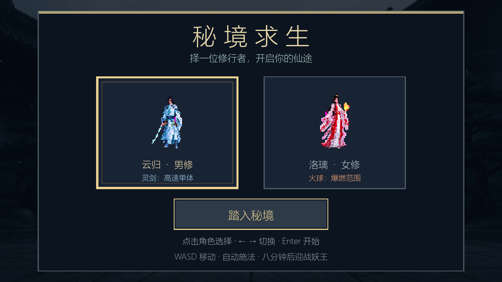
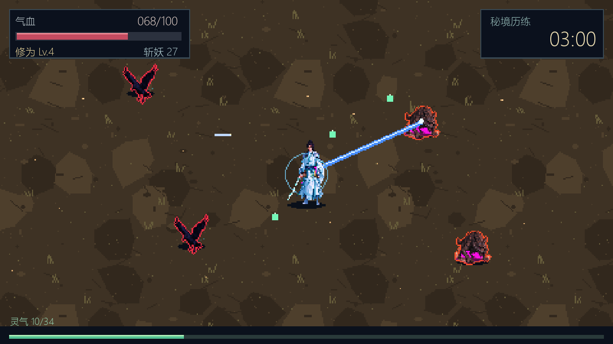
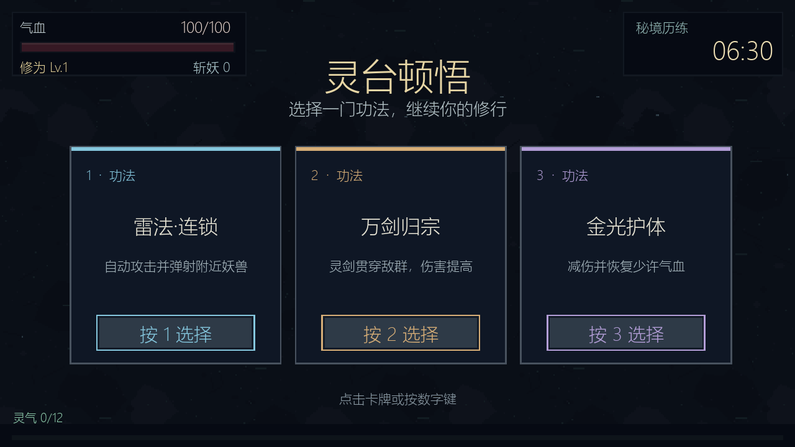
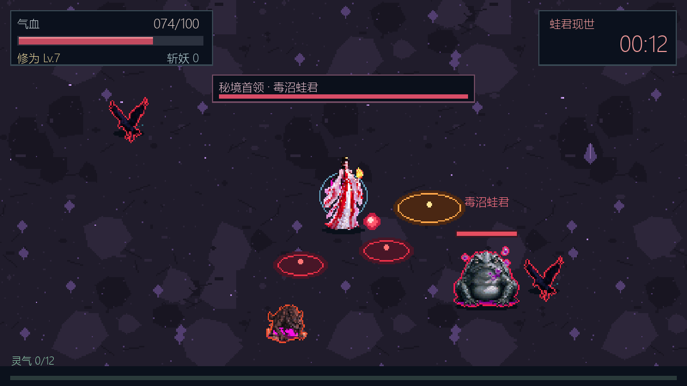

# 修仙幸存者

一个用 Python 和 pygame-ce 制作的修仙题材像素风生存游戏 Demo。pygame-ce 与游戏代码使用的 `pygame` 模块接口兼容，无需额外下载图片或音效素材。

## 截图

| 主菜单 | 战斗 |
| --- | --- |
|  |  |

| 灵台顿悟 | 毒沼蛙君 |
| --- | --- |
|  |  |

## 启动

需要 Python 3.10 或更高版本。Windows 可在项目目录运行：

```powershell
py -m venv .venv
.venv\Scripts\Activate.ps1
python -m pip install -r requirements.txt
python main.py
```

如果 `py` 不可用，请先从 [python.org](https://www.python.org/downloads/) 安装 Python，并启用安装器中的 PATH 选项。首次启动时需要联网安装 Pygame。

## 操作

- `W A S D` / 方向键：移动
- `P` / `Esc`：暂停或继续
- 切换到其他窗口时自动暂停
- 升级时按 `1`、`2`、`3` 选择突破，或用鼠标点击
- 菜单和结算界面可按 `Enter` 开始或重新开始
- `F11`：切换全屏

游戏默认以 1280×720 窗口显示，可拖动窗口调整大小。画面按 16:9 比例适配窗口，并使用最近邻缩放保持像素边缘清晰；窗口比例不同时会在两侧或上下留出背景边框。

一局约 8 分钟。地图无限延伸，镜头始终以角色为中心，可以自由走位；战斗地面为无缝纹理并随镜头滚动，主菜单保留场景插画。秘境会从山门古道转入荒野山谷，最终进入毒沼灵窟。乌鸦妖会缓慢靠近并以接触伤害骚扰，妖狼持续追猎并近身撕咬；敌人轮廓与敌方攻击以亮红色突出显示。灵剑会自动瞄准最近的妖兽。收集灵气升级后，在三种随机功法中选择一种；其中「雷法·连锁」会作为第二套自动攻击，与当前普攻并存，命中后弹射附近妖兽。八分钟后毒沼蛙君登场，会喷吐毒泡并留下毒池。

开始前可在菜单中选择男性修士云归或女性修士洛璃，方向键也可切换。云归以高速灵剑攻击单个目标；洛璃以较慢的火球攻击并造成范围爆燃，选择「焚天业火」后还会留下只伤害敌人的灼烧地带。角色和妖兽像素图均基于项目所有者提供的参考图生成；素材说明见 [`assets/third_party/CREDITS.md`](assets/third_party/CREDITS.md)。

## 开发与测试

项目自带无头回归测试，使用标准库 `unittest`，不需要额外依赖：

```powershell
.venv\Scripts\Activate.ps1
python -m unittest discover -s tests -v
```

重新生成 README 截图：

```powershell
python tools\capture_screens.py
```

测试使用 SDL 的 dummy 视频/音频驱动，不会弹出窗口。GitHub Actions 会在 Python 3.10 / 3.12 上运行同一套测试。

## 目录结构

- `game.py`：玩家、敌人、弹幕、升级与 Boss 的状态和模拟
- `renderer.py`：画面、HUD、菜单与升级卡绘制
- `layout.py`：绘制和点击检测共用的 UI 矩形
- `main.py`：入口与主循环
- `tests/`：无头回归测试
- `tools/`：截图等开发脚本
- `assets/`：角色、敌人、背景与第三方素材说明

## 字体

界面文字使用系统中文字体：Windows 下优先使用微软雅黑，Linux 下建议安装 Noto Sans CJK。没有中文字体时游戏仍能运行，但文字会显示为方框。

## License

代码采用 MIT 许可证；第三方素材（CC0）与生成美术的来源说明见 [`assets/third_party/CREDITS.md`](assets/third_party/CREDITS.md)。
